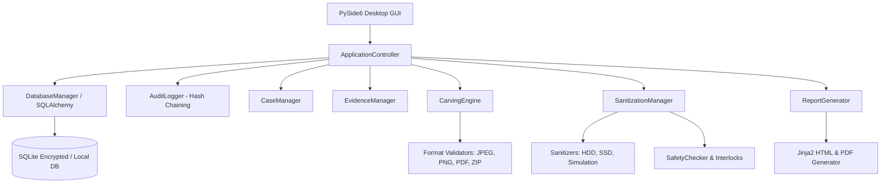

# Forensic Platform - Developer & Architecture Guide

**Version:** 1.0.0  
**Target Audience:** Core Contributors, Security Engineers, and Forensic Tool Developers.

---

## 1. Architectural Architecture

The Forensic Platform is architected with strict separation of concerns, decoupling the presentation layer from the forensic and cryptographic execution engines.



### Core Subsystems
- **`core/app_controller.py`:** Dependency injection hub and central coordinator holding instances of database, audit, configuration, and worker managers.
- **`database/`:** SQLAlchemy 2.0 ORM models (`models.py`) with thread-safe session management (`session.py`) and schema migrations.
- **`audit/`:** Cryptographic hash-chained tamper-evident event logging engine (`audit_logger.py`, `hash_chain.py`).
- **`carving/`:** High-throughput binary signature carving engine with format-specific validators (`jpeg_validator.py`, `png_validator.py`, etc.).
- **`sanitization/`:** Device discovery, hardware classification, safety interlocks, and multi-pass overwriting engines.
- **`reporting/`:** Multi-format report builder emitting PDF, HTML, JSON, and CSV court documents.
- **`gui/`:** PySide6 modular widgets, responsive navigation stack, and dynamic dark/light theme manager.

---

## 2. Database Models & Schema

The platform persists state in a local SQLite database utilizing foreign key cascades, check constraints, and indexed lookups.

### Key Entities
1. **`Case` (`cases` table):**
   - Stores case metadata (`case_number`, `title`, `investigator`, `status`, `created_at`).
   - One-to-many relationship with `Evidence`, `Operation`, and `Report`.
2. **`Evidence` (`evidence` table):**
   - Digital media registration records (`evidence_number`, `source_type`, `image_path`, `size_bytes`).
   - Dual cryptographic baselines (`sha256`, `md5`) and chain of custody timeline.
3. **`Operation` (`operations` table):**
   - Execution track for carving, recovery, drive sanitization, or hashing jobs.
   - Captures start/end timestamps, operator name, parameters (JSON), and status.
4. **`RecoveredFile` (`recovered_files` table):**
   - Carved or restored files (`filename`, `file_type`, `size`, `offset`, `sha256`, `confidence_score`).
5. **`AuditEvent` (`audit_events` table):**
   - Immutable audit ledger. Each row includes `timestamp`, `user`, `event_type`, `event_category`, `event_data` (JSON), `previous_hash`, and `event_hash` (SHA-256).
6. **`Report` (`reports` table):**
   - Generated report records (`report_type`, `format`, `file_path`, `report_hash`, `generated_by`).

---

## 3. Extending the File Carving Engine

Adding a new file format carver requires implementing a subclass of `BaseValidator`.

### Example: Adding a GIF Validator
1. Create `src/forensics_platform/carving/validators/gif_validator.py`:
```python
from typing import Tuple, Optional
from forensics_platform.carving.validators.base_validator import BaseValidator

class GIFValidator(BaseValidator):
    """Validator for GIF87a and GIF89a image formats."""
    
    def __init__(self):
        super().__init__("gif")

    def validate(self, data: bytes, offset: int = 0) -> Tuple[bool, int, int]:
        """
        Validates GIF header and seeks 0x3B (trailer).
        
        Returns:
            Tuple of (is_valid: bool, file_size: int, confidence: int)
        """
        if len(data) < 6:
            return False, 0, 0

        header = data[:6]
        if header not in (b"GIF87a", b"GIF89a"):
            return False, 0, 0

        # Find GIF trailer byte (0x3B)
        trailer_idx = data.find(b"\x3B", 6)
        if trailer_idx != -1:
            file_size = trailer_idx + 1
            return True, file_size, 90

        # Truncated or incomplete trailer
        return True, len(data), 50
```

2. Register your validator in `src/forensics_platform/carving/validators/__init__.py` and add the signature to `data/signatures.json`.

---

## 4. Extending the Sanitization Engine

All drive wiping algorithms inherit from `BaseSanitizer`.

### Implementing a Custom Overwrite Routine
```python
from forensics_platform.sanitization.sanitizers.base_sanitizer import BaseSanitizer
from forensics_platform.sanitization import DeviceInfo, SanitizationResult

class CustomPatternSanitizer(BaseSanitizer):
    def sanitize(self, device: DeviceInfo, **kwargs) -> SanitizationResult:
        self.logger.info(f"Starting custom sanitization on {device.device_path}")
        
        chunk_size = 1024 * 1024  # 1 MB buffer
        pattern = b"\xAA" * chunk_size
        bytes_written = 0

        with open(device.device_path, "r+b") as target:
            while bytes_written < device.size_bytes:
                to_write = min(chunk_size, device.size_bytes - bytes_written)
                target.write(pattern[:to_write])
                bytes_written += to_write
                
        return SanitizationResult(
            success=True,
            passes_completed=1,
            bytes_written=bytes_written,
        )
```

---

## 5. GUI Development & Theme Styling

The GUI utilizes PySide6 with custom styling provided by `ThemeManager`.

### Theme Guidelines
- Never hardcode hexadecimal colors inside widget files.
- Always use tokens from `get_current_theme()`:
  ```python
  theme = get_current_theme()
  my_button.setStyleSheet(f"""
      QPushButton {{
          background-color: {theme.accent};
          color: {theme.accent_text};
          border-radius: 6px;
      }}
  """)
  ```
- Implement `apply_theme()` methods on widgets to dynamically update colors during runtime theme switches without restarting the application.

---

## 6. Testing & Quality Assurance

### Running Unit Tests
```bash
venv/bin/pytest tests/unit/ -v
```

### Running Integration & Security Tests
```bash
venv/bin/pytest tests/integration/ -v
```

### Running Headless E2E GUI Tests
```bash
QT_QPA_PLATFORM=offscreen venv/bin/pytest tests/e2e/ -v
```

### Running Complete Verification with Coverage
```bash
QT_QPA_PLATFORM=offscreen venv/bin/pytest tests/ --cov=src/forensics_platform -v
```
All phase verification scripts can be executed directly from `scripts/verify_phase*.py`.
